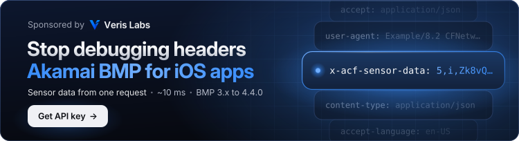

<div align="center">


**End-to-end FairPlay decrypter for App Store apps.**
*Give it a bundle ID, get a decrypted `.ipa`. And yes - it happily decrypts iOS 26 apps.*

[](https://golang.org/)
[](#install)
[](#install)
[](#install)
[](#license)
[](https://github.com/londek/ipadecrypt/pulls)


<a href="https://verislabs.io/?utm_source=github&amp;utm_medium=readme&amp;utm_campaign=ipadecrypt"></a>

</div>

## One bootstrap, three flows

```sh
ipadecrypt bootstrap
ipadecrypt decrypt <app-id|bundle-id|url|local.ipa>
```

Choose a flow at the start of `bootstrap`. The choice is saved after setup
succeeds and used by ordinary `decrypt`. Run `bootstrap` again to switch, or
select directly with `--flow original`, `--flow snapshot` or `--flow mac`.
`decrypt` prints the selected flow before processing either an App Store app or
a local IPA.

| Choice | Store sign-in | Decryption credential | When an iPhone is needed |
| --- | --- | --- | --- |
| **Framework sign-in** | Framework-backed authentication | Extracted from a jailbroken iPhone | Credential mint and optional on-device decrypt fallback |
| **Offline anisette** | GSA/AMD generated from captured iPhone state, with native iPhone signing | Extracted from a jailbroken iPhone | Snapshot capture, native sign-in and purchase operations, mint and optional fallback |
| **Mac Store** | ipatool authentication | Created and verified on this Mac | No iPhone operations in this flow |

**Mac Store creates fresh FairPlay enrollment during bootstrap.** Select an app
by ID, bundle ID or App Store URL. Setup checks ownership, acquires a license
only if the app is free, and creates account state in an isolated runtime.
It downloads a personalized IPA, recovers the credential from that state and
verifies the decrypted output. No existing native SIDB or administrator access
is required. A cached credential with a valid verification report is reused.

A new Apple account may require email verification and acceptance of Apple
Media Services terms. Complete those steps in Apple's website or Mac App Store
when prompted, then rerun bootstrap. A terms link opens the specific page in
App Store; signing in or dismissing the welcome screen alone may not complete
this step. If Apple requires another sign-in, run `bootstrap --flow mac --reset`.
ipadecrypt does not accept terms on your behalf.

Support for a completely clean macOS installation is unverified. Apple account
onboarding can require the browser and Mac App Store UI.

Mac recovery verifies the decrypted output independently before saving the
credential. Mac decryption requires that verified credential, never falls back
to an iPhone, and never overwrites an output file. `bootstrap --remint` repeats
recovery while retaining the previous credential and report as backups.

```sh
ipadecrypt bootstrap --flow mac
ipadecrypt decrypt <app-id> -o decrypted.ipa
ipadecrypt decrypt encrypted.ipa -o decrypted.ipa
```

When a Mac download lacks a license, `decrypt` automatically acquires it only
if the app is confirmed free, then retries the download ticket once. Paid apps
require an existing license. An uncertain purchase result stops the command.
Mac bootstrap applies the same free-app restriction when acquiring a license.
`--external-version-id` selects a known build; `--refresh-ticket` bypasses the
verified encrypted IPA cache and requests a fresh ticket.

Mac sessions and credentials live under `~/.ipadecrypt/mac-store`, separately
from the device flows. Existing configurations retain their sign-in mode and
cached snapshot paths. Switching flows does not delete their saved state.
Mac operations have a 30-minute deadline, including setup and verification codes.

## How it works

ipadecrypt decrypts FairPlay apps **on your computer** using a reusable account
credential. The device flows extract it from a jailbroken iPhone; Mac Store
creates enrollment and recovers it locally. Downloading requires an App Store
session, but decryption of a local IPA with a cached credential is offline.

The offline decryptor handles **arm64**, **arm64e**, **arm64_32** and
**32-bit ARM** slices, with page keys from `.supf`/`.v5.supf` or
`.supp`/`.v4.supp` files. A fat binary is thinned to one slice: the plain
arm64 slice, else arm64e, else arm64_32, else 32-bit ARM (armv7 when there
are several). The other slices are dropped from the output. **Apple Arcade**
apps need a second, Arcade credential from the same account. The device flows
mint it alongside the regular one when an Arcade app is installed. Mac Store
recovery currently prepares only the regular credential.

If an app can't be decrypted offline at all,
the Framework sign-in and Offline anisette flows fall back to decrypting it
**on your jailbroken device** when one is configured (the same device used for minting). Pass
`--no-on-device` to disable the fallback, or `--on-device` to go straight to
the device.

## Requirements

### On your computer

- **Mac Store:** macOS and an Apple account ready to use the App Store. Setup
  needs network access and an owned or free app for credential verification.
- **Framework sign-in:** a jailbroken iPhone reachable over SSH, either over the
  network or USB with `iproxy`, for mint and optional on-device fallback.
- **Offline anisette:** a jailbroken iPhone with root access over SSH and USB with
  `iproxy`. Keep it available for capture, native Store signing and purchases.
- With a cached credential, decrypting a local IPA does not require the phone.

### On the jailbroken iPhone

| Requirement | Purpose |
|---|---|
| **OpenSSH** | The mint and the on-device fallback connect over SSH (install OpenSSH from Sileo), as `root` or as a user that can `sudo` - `mobile` on Dopamine and palera1n rootless, where root has no password by default. With SSH key auth you are asked once for that user's sudo password |
| **≥1 owned App Store app installed** | Bought with the same Apple ID; used to trigger FairPlay once during the mint |
| **An Apple Arcade app installed** (optional) | From the same Apple ID; only to mint the Arcade credential that decrypts Arcade apps |
| **AppSync Unified + `appinst`** | Only for the on-device fallback: installs the app on the device so it can be decrypted |

> Tested on iOS 16.7.11 with palera1n rootless and Dopamine on iPhone 8 Plus. iOS 10+ is expected to work for minting; decryption itself runs anywhere.

## Install

Download a prebuilt binary from the [releases page](https://github.com/londek/ipadecrypt/releases/latest).

Using go install:

```sh
go install github.com/londek/ipadecrypt/cmd/ipadecrypt@latest
```

From source (refer to [BUILDING.md](BUILDING.md) for detailed instructions):

```sh
git clone https://github.com/londek/ipadecrypt
cd ipadecrypt
go build ./cmd/ipadecrypt
```

## Usage

### First-time setup

```sh
ipadecrypt bootstrap
```

Choose **Framework sign-in**, **Offline anisette** or **Mac Store**, then follow
three steps:

1. **Sign in.** Enter the Apple account and verification code when requested.
   Device flows use the account that owns the apps on the jailbroken iPhone.
2. **Prepare a credential.** Device flows mint it over SSH. If an Apple Arcade
   app from the account is installed, they also mint an Arcade credential.
   Mac Store creates fresh enrollment and verifies its credential against a
   personalized IPA. A cached credential is reused unless `--remint` is set.
3. **Check readiness.** Device flows check the optional on-device fallback
   (AppSync Unified, `appinst` and the helper); missing packages do not block
   offline decryption. Mac Store checks the credential's verification report.

The first Store operation may download Apple runtime assets; later runs reuse
the cache. Snapshot setup captures and checks device state before sign-in when
needed. The phone remains necessary for native Store operations in that flow.

Use `--reset` to sign in again; device flows also clear their saved account and
connection settings. `--skip-login` leaves device flows ready only for local
IPAs with cached credentials; Mac setup requires a saved Mac session.

### Offline anisette snapshot

Snapshot capture and generation are built into the CLI. No source checkout,
Python environment or host Frida bindings are required. Bootstrap asks for the
jailbroken iPhone's connection details and automatically deploys Frida, captures
and verifies the device state, then cleans up the temporary device files.

The default snapshot path is `~/.ipadecrypt/iphone-anisette/snapshot`.
Configured paths, including `~/.ipadecrypt/anisette/snapshot`, are supported.
Framework authentication state uses `~/.ipadecrypt/store-anisette`; the
`~/.ipadecrypt/anisette` file is also accepted for compatibility.

Keep snapshots private: they contain device provisioning state. A cached
snapshot is reused for header generation; if verification fails, bootstrap
captures it again. Native Store signing and purchase operations still use the
phone. Embedded JavaScript agents execute on the device.

### Decrypt an app

```sh
ipadecrypt decrypt <bundle-id|app-store-id|app-store-url|path-to-local-ipa>
```

This decrypts offline. In the Framework sign-in and Offline anisette flows,
unsupported apps can fall back to a configured jailbroken device. Mac Store
reports an error when offline decryption is unsupported. Useful flags:

- `--on-device` - skip the offline attempt and decrypt on the device directly.
- `--no-on-device` - disable the on-device decryption fallback. Snapshot Store signing and purchases still require the phone.
- `--keep-watch` - keep and decrypt the Watch app instead of removing it (offline only).
- `--patch-device-type` - expand `UIDeviceFamily` so an app built for a different device type still installs during the on-device fallback.
- `--no-uninstall` / `--force-uninstall` - control whether the app is removed from the device after an on-device decrypt (default: removed only if this run installed it).

### List versions of an app

```sh
ipadecrypt versions <bundle-id|app-store-id|app-store-url>
```

The version browser is available in Framework sign-in and Offline anisette.
Mac Store accepts a known build through `decrypt --external-version-id`.

## Code layout

`cmd/ipadecrypt` contains the entry point, commands, flags and TUI.
`internal/iphonesetup` handles iPhone snapshots and native Store signing.
`internal/macstore` handles Mac Store sessions and enrollment;
`internal/maccredential` recovers and verifies decryption credentials.
Run `go test ./...` and `go vet ./...` from the repository root.

To also exercise the pinned Apple runtime against synthetic Store replies and
cancellation (no account or purchases), run
`IPADECRYPT_TEST_APPLE_RUNTIME=1 go test ./internal/sap/machine ./internal/store/emulator`.
This check may download public Apple runtime assets if they are not cached.

The Mac backend uses pinned Go dependencies:

- [ipatool v2.8.1](https://github.com/majd/ipatool/tree/v2.8.1) for Store
  authentication, library queries and downloads. The local Store backend handles
  acquisition responses and the enrollment ticket while keeping the content
  runtime alive through KBSync and keybag import.
- [UnfairPlay c1753f4](https://github.com/DrWhax/unfairplay/tree/c1753f4076fceccbf3e97625ea88c0609869e978)
  for credential recovery from SIDB, followed by independent plaintext verification.

Dependencies are pinned in `go.mod` and checked through `go.sum`; no local
module copies or patches are required. To rebuild the embedded Frida agents,
see [their build instructions](internal/anisettecapture/agent/README.md).
Binary distributions must retain the applicable notices from ipatool's MIT
license and UnfairPlay's LICENSE, NOTICE, LICENSE-DARKPHOENIX.txt and
LICENSE-MACOSFAIRFREE.txt, available in the downloaded modules.

## Known issues

- Only the supported SINF/SUPF/SUPP license formats decrypt offline. Device flows can use the on-device fallback for unsupported apps; Mac Store has no device fallback.
- Credentials belong to an Apple account. The IPA must belong to the account used to mint or recover the credential.
- Only one slice per binary is decrypted: a fat binary is thinned to its plain arm64 slice, else arm64e, else arm64_32, else 32-bit ARM (armv7 when there are several). The other slices are dropped from the output. A binary with no ARM slice can't be decrypted offline.
- A Watch app kept with `--keep-watch` is thinned like any other binary (normally to arm64_32), so it does not run on Apple Watch Series 3 or earlier.
- Apple Arcade requires the account's Arcade credential, available through the device mint flows. Mac Store does not currently recover it.

## License

MIT.

## Prior art

- [EthanArbuckle/fairplay-decrypt](https://github.com/EthanArbuckle/fairplay-decrypt) - the basis of the Go offline FairPlay decryptor and credential minting.
- [majd/ipatool](https://github.com/majd/ipatool) - the Apple Configurator impersonation the App Store client is based on.
- [34306/TrollDecryptJB](https://github.com/34306/TrollDecryptJB) - `task_for_pid` + `mach_vm_read` from a suspended spawn, entitlement set.
- [JohnCoates/flexdecrypt](https://github.com/JohnCoates/flexdecrypt) - a reference for process-memory decryption.

## AI Disclaimer

Development uses AI tools alongside code review and testing.

<a href="https://star-history.dera.page/#londek/ipadecrypt&type=date&legend=top-left">
 <picture>
   <source media="(prefers-color-scheme: dark)" srcset="https://star-history.dera.page/svg?repos=londek/ipadecrypt&type=date&theme=dark&legend=top-left" />
   <source media="(prefers-color-scheme: light)" srcset="https://star-history.dera.page/svg?repos=londek/ipadecrypt&type=date&legend=top-left" />
   
 </picture>
</a>
